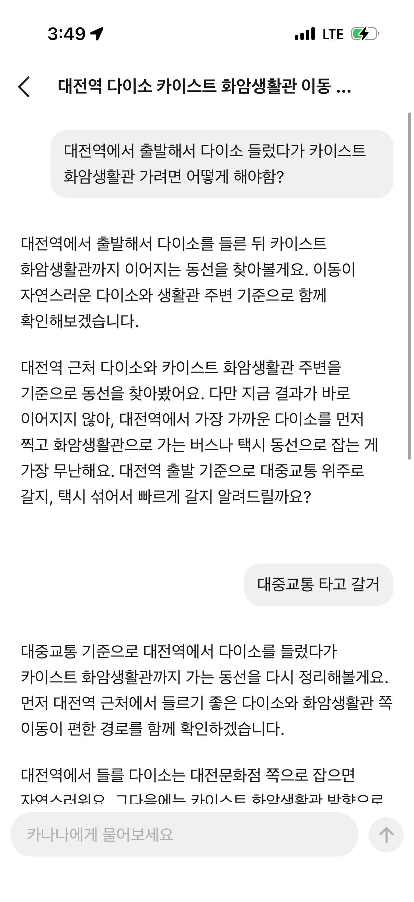
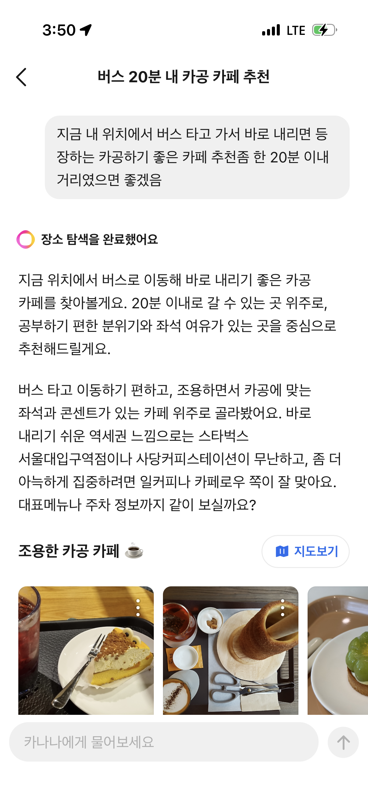
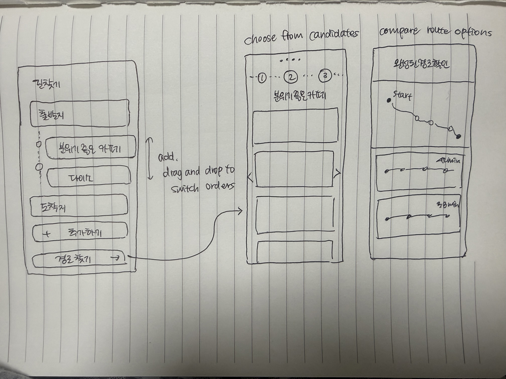

# Pitch

## Problem

대중교통으로 목적지에 가는 길에 식사할 곳을 찾으려면 경로 주변 식당을 따로 검색하고, 어느 경로 근처에 있는지 직접 비교해야 한다.

## Who else?

대중교통 이용자는 이동 중 식사할 곳을 찾으려고 목적지 경로와 식당을 따로 검색한다.

## Existing solutions

지도 앱은 대중교통 경로와 식당 검색을 제공하지만, 경로를 따라 이동 중 들르기 좋은 식당을 한눈에 찾기 어렵다.

  
  

<em>과거 카카오맵 카나나를 활용하려고 했으나 실패한 기록</em>

## Solution

출발지와 도착지를 입력하면 60분 미만의 대중교통 경로 선택지를 보여준다. 경로 하나를 선택하면 경로선에서 1km 이내 식당을 지도와 목록에 표시한다. 조건에 맞는 경로나 식당이 없으면 없다고 안내한다.

## No-gos

1) 서울 외 지역은 지원하지 않는다. 
2) 로그인 기능은 구현하지 않는다. 
3) 검색 대상은 식당으로 고정한다. 자연어 활동 입력은 구현하지 않는다.
4) 대중교통 중 버스, 지하철만 지원한다.
5) 장소를 경유하는 새 대중교통 경로 조합을 자동 계산하지 않는다. 길찾기 API가 반환한 출발지·목적지 경로 중 사용자가 선택한 경로를 기준으로 한다.
6) 장소는 사용자가 경로를 선택한 뒤 그 경로 주변에서 찾는다. 장소 방문 뒤 목적지까지 이어지는 별도 경로 최적화는 MVP에서 하지 않는다.
7) 소요시간이 60분 이상인 경로는 제외한다. 선택한 경로 근처에 식당 후보가 없으면 검색 범위를 확장하거나 다른 경로를 자동으로 찾지 않는다.
8) 하차 정류장 추천은 Kakao 경로 응답에 정류장 좌표가 없어 MVP에서 제외한다.
