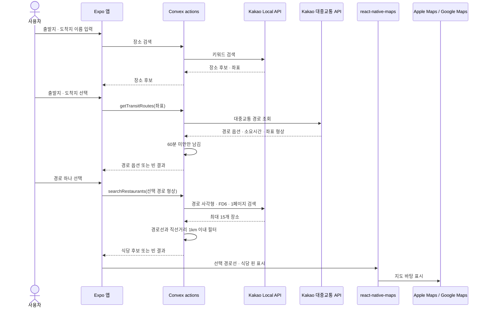

# System design — 가는김에

## Overview

가는김에는 서울에서 출발지와 목적지를 입력한 사용자에게 대중교통 경로를 보여주고, 고른 경로 근처 식당과 그 식당에 들르기 좋은 하차 정류장을 찾게 한다. 앱은 Expo, API 키를 보호하고 외부 API를 호출할 서버는 Convex, 경로와 장소 데이터는 Kakao API를 쓴다. 로그인·개인 검색 기록은 저장하지 않으며, 전체 시간이 60분 이상인 경로는 MVP에서 제외한다. 하차 정류장 안내는 핵심 기능이며 구현 검토는 [하차 정류장 매핑 후속 검토](02-1-stop-matching-follow-up.md)에서 다룬다.

## Diagram

[원본 다이어그램](architecture.mmd)

## Core flow

1. 사용자가 출발지·도착지 이름을 입력한다. Expo 앱은 Convex `searchPlaces`를 부르고, action이 Kakao Local 키워드 검색을 호출해 사용자가 좌표가 포함된 장소를 고르게 한다.
2. Expo 앱은 선택한 출발지·도착지를 Convex `getTransitRoutes`로 보낸다. action이 Kakao 대중교통 경로 API를 호출하고, 60분 미만 결과를 앱에 돌려준다. 경로가 서울 경계를 벗어나면 경로와 식당 탐색은 그대로 제공하되 하차 정류장 안내만 제공하지 않고 그 이유를 표시한다. 경로가 없으면 빈 경로 상태를 보여준다.
3. 앱은 경로 선택지를 보여준다. 사용자가 하나를 고르면 Expo 앱이 선택 경로의 좌표를 지도에 선으로 표시하고, 경로 좌표를 Convex `searchRestaurants`로 보낸다.
4. `searchRestaurants`는 선택 경로 좌표의 사각형 범위를 각 방향 1km 넓혀 Kakao Local 음식점(FD6)을 한 번 검색한 뒤, 반환된 장소 중 경로선과 직선거리 1km 이내인 것만 앱에 돌려준다.
5. 앱은 식당을 지도 핀과 목록으로 보여준다. 후보가 없으면 빈 결과를 안내하며 추가 검색은 하지 않는다.

경로 시간이 60분 이상이거나 식당 후보가 없으면 빈 결과를 보여주고, 자동으로 범위를 넓히거나 다른 경로를 찾지 않는다.

### 서울 경계와 하차 정류장 안내

하차 정류장 좌표 보강은 서울시 버스 정류소 데이터에 의존하므로, Kakao 경로의 전체 형상이 서울 경계 안에 있을 때만 제공한다. 경로가 서울 밖으로 나가거나 경로 형상을 확인할 수 없으면 `stopGuidanceAvailable: false`와 사유를 반환하고, 앱에는 “서울 경계를 벗어나는 경로라 하차 정류장 정보는 제공되지 않습니다”라고 안내한다. 이 경우에도 경로 선택, 지도 표시, 경로 주변 식당 검색은 정상 제공한다. 경로 후보 자체를 제거하거나 전체 검색을 실패 처리하지 않는다.

경계 판단은 정류장 이름이나 출발·도착지만으로 하지 않고 경로 전체의 좌표 형상을 서울시 행정 경계와 대조한다. 수동 검토 도구와 표본 수집 스크립트도 같은 조건을 적용해 서울 밖으로 나가는 경로는 서울 표본에 포함하지 않는다. 현재 경계 파일은 2017년 서울 자치구 GeoJSON이므로 운영 적용 전 최신 공식 경계 데이터로 교체하고, 경계 데이터 갱신 절차를 마련해야 한다.

### 버스 정류소 매칭

경로가 서울 경계 안에 있고 정류소 이름 후보가 있으면, 이름으로 서울시 버스 정류소 데이터를 검색한 뒤 각 후보 좌표와 해당 버스 구간 경로선 사이의 거리를 비교해 가장 가까운 정류소를 선택한다. 이름은 후보 검색에만 쓰며 정류소 ID가 실제 레코드 식별자다. 데모를 사람이 검토한 결과 전반적으로 잘 맞는다는 의견에 따라 현재 최근접 후보 규칙을 기본 구현 방식으로 정했다. 아직 정량 성공률이나 거리 임계값은 확정하지 않았다. 상세 근거와 검토 흐름은 [후속 검토 문서](02-1-stop-matching-follow-up.md)를 참고한다.

## Data

사용자 계정·검색 기록은 저장하지 않는다. 요청·화면에 필요한 값은 메모리에서 유지한다.

| 데이터 | 필드 | 동일 항목 기준 |
|---|---|---|
| 선택 장소 | Kakao 장소 ID, 이름, 경도·위도 | Kakao 장소 ID |
| 경로 선택지 | 현재 응답 내 순번, 총 시간, 환승 수, 좌표 형상 | 현재 응답의 순번. 영구 ID로 저장하지 않음 |
| 식당 후보 | Kakao 장소 ID, 이름, 주소, 경도·위도, 경로선까지 직선거리 | Kakao 장소 ID |

## Data sources

- **출발지·도착지 장소:** [Kakao Local 키워드 검색](https://developers.kakao.com/docs/ko/kakaomap/rest-api)을 요청 때 호출한다. 서울역·강남역 검색 모두 HTTP 200으로 좌표가 포함된 후보 5개를 반환했다 ([실호출 샘플](samples/kakao-place-search-current.json)). 결과가 없으면 검색어를 다시 입력한다. 앱의 검색·선택 UI는 미구현이다.
- **대중교통 경로:** [Kakao 대중교통 경로 API](https://developers.kakao.com/docs/ko/kakaomap/rest-api)를 검색 요청 때 호출한다. 서울역→강남역 한 번의 실호출에서 HTTP 200과 15개 경로를 받았고, 11개가 60분 미만이었다. 첫 경로는 36분 39초, 환승 1회였다. 경로가 없거나 모두 60분 이상이면 가능한 경로가 없다고 안내한다.
- **경로 주변 식당:** [Kakao Local 음식점 카테고리 FD6](https://developers.kakao.com/docs/ko/kakaomap/rest-api)을 선택 경로마다 한 번 호출한다. 실험은 `page=1`, `size=15`, `sort=accuracy`로 검색했다. 첫 페이지 15곳 중 5곳이 경로선에서 직선거리 1km 이내였다. `total_count`는 16,858, `pageable_count`는 45여서 첫 페이지 밖의 후보는 이번 방식으로 찾지 못할 수 있다. 1km는 실제 도보 거리가 아니다. 현재 Kakao 안내의 일일 무료 쿼터는 대중교통 경로 1,000건, 키워드·카테고리 검색 각각 100,000건이며, 추가 쿼터는 경로 10원/호출, 검색 2원/호출로 안내된다. 쿼터·요금은 바뀔 수 있다. ([쿼터·요금](https://developers.kakao.com/docs/ko/getting-started/quota))
- **지도 바탕:** Expo Go 지원으로 표시된 [`react-native-maps`](https://docs.expo.dev/versions/v58.0.0/sdk/map-view/)를 설치했다. 개발용 화면에서 정적 경로선과 출발·도착·식당 마커가 Expo Go 실기기에 표시되는 것을 확인했다 ([캡처](map.PNG)). Android 스토어 빌드에는 Google Maps 설정이 필요하다.

실호출은 [`verify-core-flow.mjs`](../scripts/verify-core-flow.mjs)로 수행했다. 결과는 [핵심 검증 샘플](samples/current-core-validation.json), 요약은 [검증 기록](samples/current-flow-validation.md)에 있다. Kakao 키는 앱에 넣지 않고 Convex 환경변수에 둔다. 요청은 사용자가 보낼 때만 실행한다.

## Decisions

### Kakao 호출은 Convex 서버에서 한다

선택지: 앱에서 직접 호출하거나 Convex action을 거친다. **Convex를 선택했다.** 앱 번들에 Kakao 비밀 키를 넣지 않기 위해서다. 대신 Convex 연결과 배포 환경 설정이 필요하며, 현재 실험은 로컬 스크립트에서만 했다.

### 사용자가 고른 경로만 한 번 검색한다

선택지: 모든 경로를 먼저 검색하거나, 경로를 따라 여러 반경 검색을 하거나, 선택한 경로의 사각형을 한 번 검색한다. **마지막 방식을 선택했다.** API 호출과 구현을 줄인다. 대신 첫 페이지의 결과만 보고, 경로와의 직선거리를 도보 거리처럼 취급하지 않는다.

### MVP에서는 식당만 보여준다

선택지: 처음부터 자연어 쿼리로 여러 활동을 검색하거나, 한 가지 검색 대상으로 범위를 제한한다. **현재 투입할 수 있는 리소스를 고려해 식당만 검색한다.** 리소스가 확보되면 자연어 쿼리를 받아 활동 종류에 맞는 장소를 찾도록 확장한다.
