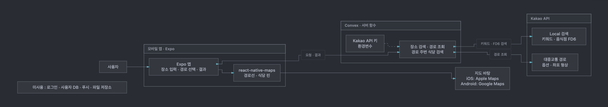
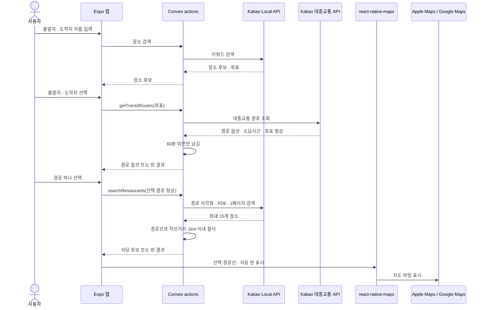

# System design — 가는김에

## Overview

가는김에는 서울에서 출발지와 목적지를 입력한 사용자에게 대중교통 경로를 보여주고, 고른 경로 근처 식당을 지도와 목록으로 찾게 한다. 앱은 Expo, API 키를 보호하고 외부 API를 호출할 서버는 Convex, 경로와 장소 데이터는 Kakao API를 쓴다. 로그인·개인 데이터 저장은 없고, 전체 시간이 60분 이상인 경로와 하차 정류장 추천은 MVP에서 제외한다.

## Diagram

[원본 다이어그램](architecture.mmd)

## Core flow

1. 사용자가 출발지·도착지 이름을 입력한다. Expo 앱은 Convex `searchPlaces`를 부르고, action이 Kakao Local 키워드 검색을 호출해 사용자가 좌표가 포함된 장소를 고르게 한다.
2. Expo 앱은 선택한 출발지·도착지를 Convex `getTransitRoutes`로 보낸다. action이 Kakao 대중교통 경로 API를 호출하고, 60분 미만 결과만 앱에 돌려준다. 없으면 빈 경로 상태를 보여준다.
3. 앱은 경로 선택지를 보여준다. 사용자가 하나를 고르면 Expo 앱이 선택 경로의 좌표를 지도에 선으로 표시하고, 경로 좌표를 Convex `searchRestaurants`로 보낸다.
4. `searchRestaurants`는 선택 경로 좌표의 사각형 범위를 각 방향 1km 넓혀 Kakao Local 음식점(FD6)을 한 번 검색한 뒤, 반환된 장소 중 경로선과 직선거리 1km 이내인 것만 앱에 돌려준다.
5. 앱은 식당을 지도 핀과 목록으로 보여준다. 후보가 없으면 빈 결과를 안내하며 추가 검색은 하지 않는다.

경로 시간이 60분 이상이거나 식당 후보가 없으면 빈 결과를 보여주고, 자동으로 범위를 넓히거나 다른 경로를 찾지 않는다.

## Data

사용자 계정·검색 기록 저장 요구가 없어 영구 데이터베이스는 두지 않는다. 요청·화면에 필요한 값은 메모리에서만 유지한다.

| 데이터 | 필드 | 동일 항목 기준 |
|---|---|---|
| 선택 장소 | Kakao 장소 ID, 이름, 경도·위도 | Kakao 장소 ID |
| 경로 선택지 | 현재 응답 내 순번, 총 시간, 환승 수, 좌표 형상 | 현재 응답의 순번. 영구 ID로 저장하지 않음 |
| 식당 후보 | Kakao 장소 ID, 이름, 주소, 경도·위도, 경로선까지 직선거리 | Kakao 장소 ID |

## Data sources

- **출발지·도착지 장소:** [Kakao Local 키워드 검색](https://developers.kakao.com/docs/ko/kakaomap/rest-api)을 사용자가 요청할 때 호출한다. 선택 결과의 좌표를 경로 API 입력으로 쓴다. 현재 핵심 실험은 좌표를 직접 지정했으므로 이 입력 검색 UI는 아직 검증하지 않았다. 결과가 없으면 검색어를 다시 입력하게 한다.
- **대중교통 경로:** [Kakao 대중교통 경로 API](https://developers.kakao.com/docs/ko/kakaomap/rest-api)를 검색 요청 때 호출한다. 서울역→강남역 한 번의 실호출에서 HTTP 200과 15개 경로를 받았고, 11개가 60분 미만이었다. 첫 경로는 36분 39초, 환승 1회였다. 경로가 없거나 모두 60분 이상이면 가능한 경로가 없다고 안내한다.
- **경로 주변 식당:** [Kakao Local 음식점 카테고리 FD6](https://developers.kakao.com/docs/ko/kakaomap/rest-api)을 선택 경로마다 한 번 호출한다. 실험은 `page=1`, `size=15`, `sort=accuracy`로 검색했다. 첫 페이지 15곳 중 5곳이 경로선에서 직선거리 1km 이내였다. `total_count`는 16,858, `pageable_count`는 45여서 첫 페이지 밖의 후보는 이번 방식으로 찾지 못할 수 있다. 1km는 실제 도보 거리가 아니다. 현재 Kakao 안내의 일일 무료 쿼터는 대중교통 경로 1,000건, 키워드·카테고리 검색 각각 100,000건이며, 추가 쿼터는 경로 10원/호출, 검색 2원/호출로 안내된다. 쿼터·요금은 바뀔 수 있다. ([쿼터·요금](https://developers.kakao.com/docs/ko/getting-started/quota))
- **지도 바탕:** Expo 문서에서 Expo Go 지원으로 표시된 [`react-native-maps`](https://docs.expo.dev/versions/v58.0.0/sdk/map-view/)를 선택했다. iOS는 Apple Maps, Android는 Google Maps를 바탕 지도로 쓰며, 경로 형상과 Kakao 장소 좌표를 선·핀으로 덧그린다. 앱 통합은 아직 검증하지 않았다. Android 스토어 빌드에는 Google Maps 설정이 추가로 필요하다.

실호출은 [`verify-core-flow.mjs`](../scripts/verify-core-flow.mjs)로 수행했다. 결과는 [핵심 검증 샘플](samples/current-core-validation.json), 요약은 [검증 기록](samples/current-flow-validation.md)에 있다. Kakao 키는 앱에 넣지 않고 Convex 환경변수에 둔다. 요청은 사용자가 보낼 때만 실행한다.

## Decisions

### Kakao 호출은 Convex 서버에서 한다

선택지: 앱에서 직접 호출하거나 Convex action을 거친다. **Convex를 선택했다.** 앱 번들에 Kakao 비밀 키를 넣지 않기 위해서다. 대신 Convex 연결과 배포 환경 설정이 필요하며, 현재 실험은 로컬 스크립트에서만 했다.

### 사용자가 고른 경로만 한 번 검색한다

선택지: 모든 경로를 먼저 검색하거나, 경로를 따라 여러 반경 검색을 하거나, 선택한 경로의 사각형을 한 번 검색한다. **마지막 방식을 선택했다.** API 호출과 구현을 줄인다. 대신 첫 페이지의 결과만 보고, 경로와의 직선거리를 도보 거리처럼 취급하지 않는다.

### 60분 미만 경로와 식당 후보까지만 제공한다

선택지: 모든 경로를 보여주거나 60분 미만만 남긴다. 또 정류장 이름을 바탕으로 하차 지점을 추천하거나, 좌표가 없어 계산할 수 없는 추천은 뺀다. **60분 미만 경로와 식당 후보까지만 제공한다.** 실험에서 정류장 13개는 이름만 있고 ID·좌표가 없었다. 별도 정류장 데이터 연동은 MVP에서 제외한다.
