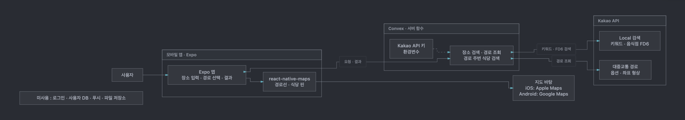
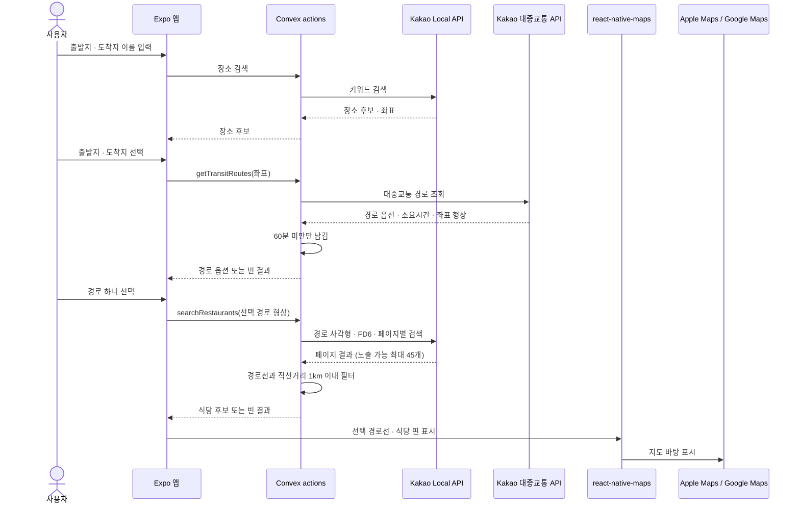

# System design — 가는김에

## Overview

가는김에는 서울에서 출발지와 목적지를 입력한 사용자에게 대중교통 경로를 보여주고, 고른 경로 근처 식당과 그 식당에 들르기 좋은 하차 정류장을 찾게 한다. 앱은 Expo, API 키를 보호하고 외부 API를 호출할 서버는 Convex, 경로와 장소 데이터는 Kakao API를 쓴다. 로그인·개인 검색 기록은 저장하지 않으며, 전체 시간이 60분 이상인 경로는 MVP에서 제외한다. 하차 정류장 매핑 검토는 [02-1 후속 문서](02-1-stop-matching-follow-up.md), 경로 주변 식당 검색 범위 검토는 [02-2 후속 문서](02-2-restaurant-search-coverage.md)에서 다룬다.

## Diagram

[원본 다이어그램](architecture.mmd)

## Core flow

1. 사용자가 출발지·도착지 이름을 입력한다. Expo 앱은 Convex `searchPlaces`를 부르고, action이 Kakao Local 키워드 검색을 호출해 사용자가 좌표가 포함된 장소를 고르게 한다.
2. Expo 앱은 선택한 출발지·도착지를 Convex `getTransitRoutes`로 보낸다. action이 Kakao 대중교통 경로 API를 호출하고, 60분 미만 결과를 앱에 돌려준다. 경로가 서울 경계를 벗어나면 경로와 식당 탐색은 그대로 제공하되 하차 정류장 안내만 제공하지 않고 그 이유를 표시한다. 경로가 없으면 빈 경로 상태를 보여준다.
3. 앱은 경로 선택지를 보여준다. 사용자가 하나를 고르면 Expo 앱이 선택 경로의 좌표를 지도에 선으로 표시하고, 경로 좌표를 Convex `searchRestaurants`로 보낸다.
4. `searchRestaurants`는 MVP에서 선택 경로 주변을 5km × 5km 격자로 나누어 Kakao Local 음식점(FD6)을 검색한다. 한 경로의 비교에서 5km 셀은 12회 요청에 경로선 1km 이내 원자료 후보 103개를 찾았다. 사용자는 5km를 MVP 기본값으로 선택했다. 셀별 결과 상한에 찼고 한 경로만 비교했으므로, 실제 검색 기능을 구현한 뒤 경로별 후보 품질과 호출량을 점검한다. 상세 결과는 [02-2 후속 문서](02-2-restaurant-search-coverage.md)에 기록한다.
5. 앱은 검색 원자료 전체가 아니라 경로 근처에서 고를 만한 식당 후보를 지도와 목록으로 보여준다. 적정 목록 수와 정렬 기준은 아직 정하지 않았고, 검색 결과를 화면에 연결하는 기능도 구현되지 않았다.

경로 시간이 60분 이상이면 빈 결과를 보여준다. 식당 검색은 페이지네이션으로 최대 45개를 가져오는 방식을 우선 검토하고, 격자 비교 결과는 호출량이 커서 최적화 검토가 남아 있다. 앱 검색 구현 전에 [02-2 후속 문서](02-2-restaurant-search-coverage.md)의 결과와 대안을 반영한다.

### 하차 정류장 안내

하차 정류장 좌표 보강은 서울시 버스 정류소 DB에 의존한다. 정류소 DB에 서울 데이터만 있으므로, 서울 외 정류장은 자연스럽게 매칭 실패 처리된다. 별도의 서울 경계 체크는 하지 않는다.

매칭 실패 시 앱에는 "하차 정류장 정보를 찾지 못했습니다"라고 안내한다. 이 경우에도 경로 선택, 지도 표시, 경로 주변 식당 검색은 정상 제공한다.

### 버스 정류소 매칭

경로가 서울 경계 안에 있고 정류소 이름 후보가 있으면, 이름으로 서울시 버스 정류소 데이터를 검색한 뒤 각 후보 좌표와 해당 버스 구간 경로선 사이의 거리를 비교해 가장 가까운 정류소를 선택한다. 이름은 후보 검색에만 쓰며 정류소 ID가 실제 레코드 식별자다. 데모를 사람이 검토한 결과 전반적으로 잘 맞는다는 의견에 따라 현재 최근접 후보 규칙을 기본 구현 방식으로 정했다. 아직 정량 성공률이나 거리 임계값은 확정하지 않았다. 상세 근거와 검토 흐름은 [후속 검토 문서](02-1-stop-matching-follow-up.md)를 참고한다.

## Data

사용자 계정·검색 기록은 저장하지 않는다. 요청·화면에 필요한 값은 메모리에서 유지한다.

| 데이터 | 필드 | 동일 항목 기준 |
|---|---|---|
| 선택 장소 | Kakao 장소 ID, 이름, 경도·위도 | Kakao 장소 ID |
| 경로 선택지 | 현재 응답 내 순번, 총 시간, 환승 수, 좌표 형상 | 현재 응답의 순번. 영구 ID로 저장하지 않음 |
| 식당 후보 | Kakao 장소 ID, 이름, 주소, 경도·위도, 경로선까지 직선거리 | Kakao 장소 ID |

### Convex DB 스키마

정류소 매칭을 위해 서울시 버스 정류소 데이터를 Convex DB에 적재한다.

**busStops 테이블**

| 필드 | 타입 | 설명 |
|---|---|---|
| stationId | string | 서울시 정류소 고유 ID |
| name | string | 정류소 이름 |
| normalizedName | string | 검색용 정규화 이름 (공백 제거, 소문자 등) |
| lat | number | 위도 |
| lng | number | 경도 |

- **데이터 출처:** `data/seoul-bus.xlsx` (1만 건+)
- **적재 방식:** 별도 스크립트로 1회 적재
- **인덱스:** normalizedName (정류소 이름 검색용)

## Data sources

- **출발지·도착지 장소:** [Kakao Local 키워드 검색](https://developers.kakao.com/docs/ko/kakaomap/rest-api)을 요청 때 호출한다. 서울역·강남역 검색 모두 HTTP 200으로 좌표가 포함된 후보 5개를 반환했다 ([실호출 샘플](samples/kakao-place-search-current.json)). 결과가 없으면 검색어를 다시 입력한다. 앱의 검색·선택 UI는 미구현이다.
- **대중교통 경로:** [Kakao 대중교통 경로 API](https://developers.kakao.com/docs/ko/kakaomap/rest-api)를 검색 요청 때 호출한다. 서울역→강남역 한 번의 실호출에서 HTTP 200과 15개 경로를 받았고, 11개가 60분 미만이었다. 첫 경로는 36분 39초, 환승 1회였다. 경로가 없거나 모두 60분 이상이면 가능한 경로가 없다고 안내한다.
- **경로 주변 식당:** [Kakao Local 음식점 카테고리 FD6](https://developers.kakao.com/docs/ko/kakaomap/rest-api)을 선택 경로마다 검색한다. 기존 1페이지 결과는 `size=15`, `sort=accuracy`로 한 번 호출해 경로선 1km 이내 5곳을 찾았다. 페이지네이션 검증에서는 3회 요청으로 중복 없는 45곳 중 18곳이 1km 이내였다. 격자 비교에서는 50개 셀에 131회 요청해 원자료 후보 1,816곳, 그중 1,214곳이 1km 이내였지만, 40개 셀이 각각 노출 상한 45곳에 도달했다. 원자료 후보 수를 사용자 화면에 보여줄 목표로 삼지 않으며, 격자 호출량과 셀 포화, 사용자에게 보여줄 적정 후보 수·정렬 기준을 함께 검토해야 한다. 앱의 실제 검색 기능은 미구현이다. 1km는 실제 도보 거리가 아니다. 현재 Kakao 안내의 일일 무료 쿼터는 대중교통 경로 1,000건, 키워드·카테고리 검색 각각 100,000건이며, 추가 쿼터는 경로 10원/호출, 검색 2원/호출로 안내된다. 쿼터·요금은 바뀔 수 있다. ([쿼터·요금](https://developers.kakao.com/docs/ko/getting-started/quota))
- **지도 바탕:** Expo Go 지원으로 표시된 [`react-native-maps`](https://docs.expo.dev/versions/v58.0.0/sdk/map-view/)를 설치했다. 개발용 화면에서 정적 경로선과 출발·도착·식당 마커가 Expo Go 실기기에 표시되는 것을 확인했다 ([캡처](map.PNG)). Android 스토어 빌드에는 Google Maps 설정이 필요하다.

실호출은 [`verify-core-flow.mjs`](../scripts/verify-core-flow.mjs)로 수행했다. 결과는 [핵심 검증 샘플](samples/current-core-validation.json)에 있고, 식당 페이지네이션 결과는 [02-2 후속 문서](02-2-restaurant-search-coverage.md)에 요약했다. Kakao 키는 앱에 넣지 않고 Convex 환경변수에 둔다.

## Decisions

### Kakao 호출은 Convex 서버에서 한다

선택지: 앱에서 직접 호출하거나 Convex action을 거친다. **Convex를 선택했다.** 앱 번들에 Kakao 비밀 키를 넣지 않기 위해서다. 대신 Convex 연결과 배포 환경 설정이 필요하며, 현재 실험은 로컬 스크립트에서만 했다.

### 사용자가 고른 경로만 검색하고 페이지를 순회한다

선택지: 모든 경로를 먼저 검색하거나, 경로를 따라 작은 영역을 여러 번 검색하거나, 선택한 경로의 사각형에서 결과 페이지를 순회한다. 페이지네이션과 격자 방식을 비교한 뒤, 사용자는 5km 셀을 MVP 기본 검색 크기로 결정했다. 한 경로에서는 12회 요청으로 경로선 1km 이내 원자료 후보 103개를 찾았다. 실제 앱 구현 후 다른 경로에서도 후보 품질과 호출량을 점검한다. 세부 결과는 [02-2 후속 문서](02-2-restaurant-search-coverage.md)를 참고한다.

### MVP에서는 식당만 보여준다

선택지: 처음부터 자연어 쿼리로 여러 활동을 검색하거나, 한 가지 검색 대상으로 범위를 제한한다. **현재 투입할 수 있는 리소스를 고려해 식당만 검색한다.** 리소스가 확보되면 자연어 쿼리를 받아 활동 종류에 맞는 장소를 찾도록 확장한다.
