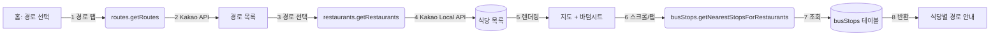

# First Slice — 버스 경로 주변 식당과 하차 정류장 확인

## 핵심 흐름

> **버스 경로 주변 식당을 선택**하면, 서울시 정류소 데이터에서 **가장 가까운 하차 정류장이 계산**되어, **지도와 바텀시트에 경로 안내가 표시**된다.

## 다이어그램

## 스크린샷

<!-- 스크린샷 추가 예정 -->

1. 앱 진입 — 경로 후보 목록
2. 경로 선택 — 지도에 경로선 표시
3. 식당 목록 로딩 — 바텀시트에 식당 표시
4. 식당 선택 — 경로 하이라이트 + 가는 방법 표시
5. 스크롤 — 다른 식당으로 지도 이동
6. 에러 상태 — 정류장 매핑 실패 시 경로 안내 생략
