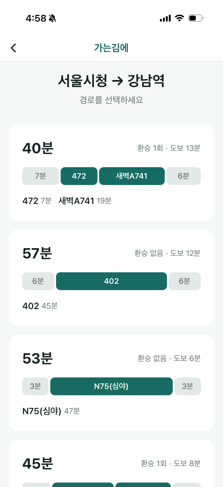
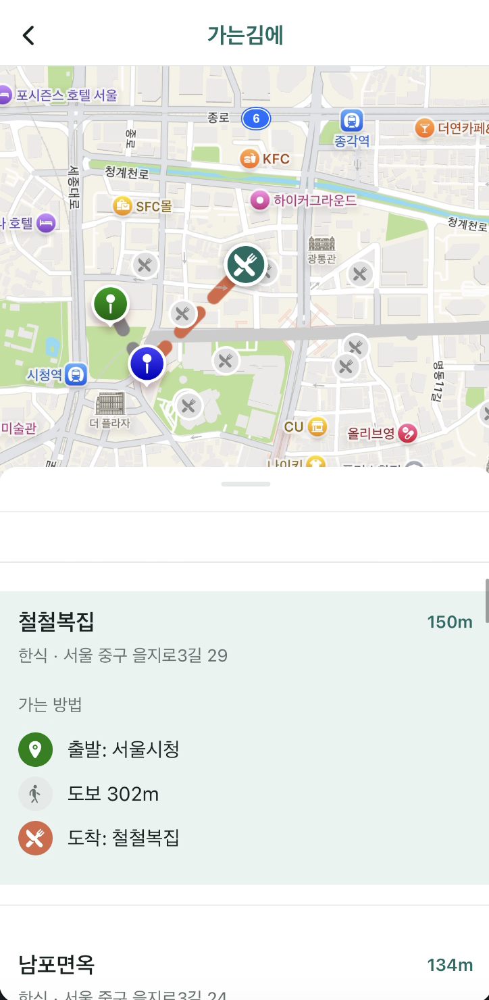

# First Slice — 버스 경로 주변 식당과 하차 정류장 확인

## 핵심 흐름

> **버스 경로 주변 식당을 선택**하면, 서울시 정류소 데이터에서 **가장 가까운 하차 정류장이 계산**되어, **지도와 바텀시트에 경로 안내가 표시**된다.

## 다이어그램

## 스크린샷

### 1. 경로 선택 후 식당 목록 표시

### 2. 식당 탐색 흐름 (스크롤 → 지도 이동 → 경로 안내)

<video src="flow2.MP4" width="300" controls></video> 

> 영상: 바텀시트 스크롤 시 식당 자동 선택, 지도 이동, 경로 하이라이트 변경
