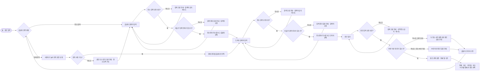
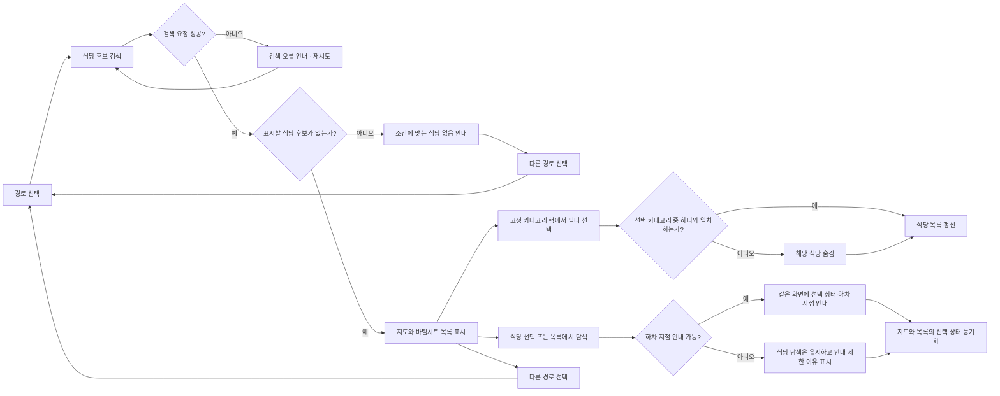

# 가는김에 MVP 사용자 흐름 초안

> **상태:** 제품 대화에서 확인한 결정을 엮은 사용자 흐름 초안. 상세 화면 배치와 문구는 아직 확정하지 않았다. 구현 완료를 뜻하지 않는다.

## 사용자와 목표

- **사용자:** 서울에서 대중교통으로 이동하며 가는 길에 들를 식당을 찾는 사람
- **목표:** 출발지·도착지에 맞는 경로를 고르고, 경로 주변 식당과 식당에 가기 좋은 하차 정류장·역을 확인한다.
- **성공:** 사용자가 도움 없이 두 장소를 선택하고, 자신이 입력한 장소에 맞는 경로를 찾아 식당을 선택한 뒤 하차 지점을 설명할 수 있다.

## 1. 장소를 고르고 경로 찾기

**화면 규칙:** 출발지·도착지는 Kakao Local 검색 결과에서 각각 선택한다. 검색 결과에는 장소명과 도로명 주소를 우선 표시하고, 도로명 주소가 없으면 지번 주소를 표시한다. 선택한 좌표로 Kakao 대중교통 경로를 요청한다. 장소 검색은 서울 안 결과로 제한한다.

홈에는 현재 위치 중심 지도를 띄우지 않고 출발지·도착지 입력을 중심으로 둔다. 출발지 검색을 기본으로 제공하고, 사용자가 명시적으로 누를 수 있는 `현재 위치` 보조 동작을 둔다. 앱 시작만으로 위치 권한을 요청하지 않는다.

경로 선택 화면에는 `전체`, `버스`, `지하철`, `버스 + 지하철` 탭을 둔다. 탭마다 60분 미만 경로 개수를 표시하며, 0개인 유형 탭은 비활성화한다. `전체`는 기본 선택이다. 경로 없음, 전부 60분 이상, API 오류는 서로 다른 상태로 안내한다.

## 2. 경로 주변 식당을 살펴보고 하차 지점 확인

**화면 규칙:** 식당 후보는 출발지에서 도착지 방향의 경로 순으로 보여준다. 서버 반환 후보를 모두 목록에 표시하고, 결과가 많으면 스크롤한다. 카테고리 칩은 바텀시트 드래그 핸들 아래 고정 행에 둔다. 여러 칩을 고르면 어느 하나라도 일치하는 식당을 표시하고, 칩을 모두 해제하면 필터 없이 전체 식당을 표시한다.

식당을 고르면 별도 상세 화면으로 이동하지 않는다. 현재 결과 화면에서 선택 식당의 하차 정류장·역 안내를 펼치고, 지도와 목록의 선택 상태를 연결한다. 하차 지점 매칭이 실패하거나 서울 경계를 벗어난 경로라면 경로와 식당 탐색은 유지하고 하차 안내가 빠진 이유를 표시한다.

## 식당 검색과 하차 후보 규칙

- 경로를 500m 간격으로 샘플링한다.
- 각 샘플 점에서 Kakao Local 음식점(FD6)을 반경 300m로 검색한다.
- 장소 ID를 기준으로 중복을 제거한다.
- 경로 형상에서 직선거리 200m 이내 후보만 남긴다.
- 샘플 구간마다 경로에 가장 가까운 식당을 최대 5곳 반환하고, 경로 진행 순으로 정렬한다.
- 매칭된 하차 정류장·역과 식당의 직선거리가 400m 이상이면 식당 후보에서 제외한다. 이 값은 실제 도보 거리가 아니다.
- 하차 정류장·역을 찾지 못한 경우에는 기존 결정대로 식당 후보를 유지하고 하차 안내가 불가능하다고 표시한다.
- 이름이 같은 정류장·역 후보 중 경로 형상에 가장 가까운 후보를 초기 매칭으로 사용한다. 거리 상한은 아직 두지 않고 실제 테스트 경로에서 확인한다.

현재 구현은 `restaurants.getRestaurantsWithStops`에서 이 400m 제외 기준을 적용한다. 매칭 실패 시 식당은 유지하며, 서울 경계 밖 경로에는 하차 매칭과 거리 제외를 적용하지 않는다.

## 주요 복구·빈 결과 상태

| 단계 | 상태 | 사용자에게 제공할 다음 행동 |
|---|---|---|
| 장소 검색 | 서울 안 검색 결과 없음 | 검색어 수정 |
| 장소 검색 | API 오류·시간 초과 | 검색어를 유지하고 재시도 |
| 경로 검색 | 대중교통 경로 없음 | 출발지·도착지 수정 |
| 경로 검색 | 경로는 있으나 모두 60분 이상 | 출발지·도착지 수정 |
| 경로 검색 | API 오류·시간 초과 | 선택 장소를 유지하고 재시도 |
| 경로 선택 | 특정 유형 경로 0개 | 해당 탭 비활성화, 경로 있는 유형 선택 |
| 식당 검색 | 검색 오류 | 재시도 또는 다른 경로 선택 |
| 식당 검색 | 조건에 맞는 후보 없음 | 다른 경로 선택 |
| 식당 선택 | 하차 지점 매칭 실패 또는 서울 경계 밖 | 경로·식당 탐색을 유지하고 안내 제한 이유 표시 |
